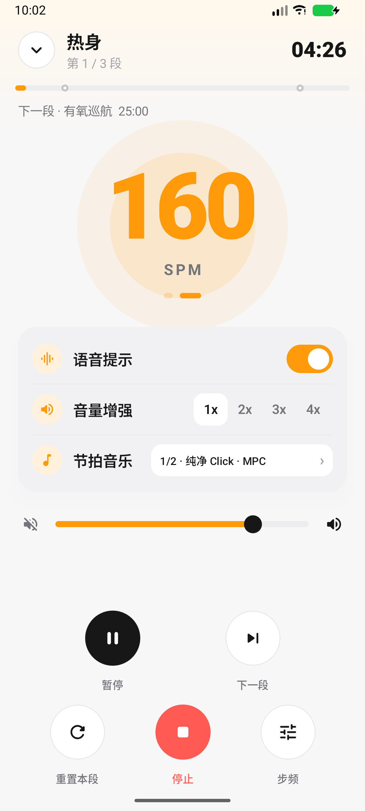

# PaceBeat · 跑步节拍器

PaceBeat 是一个受 **RunBeat（com.voyago.runbeat）** 启发的原生 Android 跑步节拍器。它保留了「按步频分段训练」的核心体验，重新实现了训练计划、节拍合成、后台播放、语音提示与通知控制，并做成一个**完全离线、无账号、无广告**的本地应用。

## 截图

| 首页 | 训练中 | 设置 |
| --- | --- | --- |
|  |  |  |

[训练模板选择](docs/screenshots/plans.png) · [节拍音乐设置](docs/screenshots/music_settings.png) · [打击乐组合](docs/screenshots/percussion_sounds.png) · [长按下一段](docs/screenshots/next_hold.png) · [长按停止](docs/screenshots/hold_stop.png) · [左滑删除](docs/screenshots/swipe_delete.png)


## 已实现功能

- **节拍音乐**
  - **14 种节拍音色**：3 种 CC0 纯净 Click + 11 种你提供的 1/2 拍打击乐组合，默认「纯净 Click · MPC」。
  - 节拍数 **1/2、1/3、1/4** 可选，默认 **1/2**；重音按所选拍数循环。
  - 11 种双音打击乐组合来自你提供的 1/2 拍 8 秒音频。
- **训练计划**
  - 内置 7 种模板：轻松跑、有氧跑、渐进跑、节奏跑、间歇跑、金字塔、法特莱克。
  - 支持空白计划；可添加、编辑分段，并通过右侧把手拖动调整顺序。左滑只露出删除按钮，不会误删。
  - 每个分段可设置名称、时长（分钟）与目标步频（100–240 SPM）。时长步进器为「左 + 右 −」，长按可连续加减。
  - 计划、设置通过 `SharedPreferences` 持久化。
- **节拍与音色**
  - 使用本地短点击采样，按 BPM 与节拍数拼成 1/2–1/4 拍小节；`AudioTrack` 静态循环保证节拍间距由采样率决定，不依赖 UI 定时器。
  - 每小节第 1 拍为重音；支持 11 种双音打击乐组合：木鱼、响棒&木鱼、邦戈鼓、双音钟、底鼓&军鼓等。
  - 音量增强 1x–4x；音量实时调节。
- **训练流程 / 控制**
  - 分段倒计时、下一段预告、总进度线、段落节点、当前拍点动画。
  - 自动切换分段；最后一段结束后进入完成页，显示实际用时、计划时长、分段数与加权平均步频。
  - 暂停/继续、重置本段、运行中调整步频。
  - **长按操作**：下一段和停止都需要按住约 1.1 秒，外圈橙色进度条填满后触发；松手可取消。
  - 语音提示：分段切换、最后 3 秒倒数、训练完成；使用系统 TTS，本地处理。
- **后台与通知**
  - 前台服务 + `PARTIAL_WAKE_LOCK`，锁屏/切后台持续播放。
  - 常驻通知显示段落、剩余时间、进度，并提供暂停/继续、下一段、停止。
  - 收起训练页后，首页显示「训练进行中」卡片，可返回训练。
- **隐私**
  - 不申请 `INTERNET` 权限，无网络请求。
  - 不申请定位、传感器、存储、通讯录等权限。
  - 仅保留通知、前台服务与唤醒锁所需权限。

## 构建与安装

### 直接安装

已签名的 release APK：[releases/PaceBeat-1.0.0.apk](releases/PaceBeat-1.0.0.apk)

```bash
adb install -r releases/PaceBeat-1.0.0.apk
```

也可以直接把 `releases/PaceBeat-1.0.0.apk` 发送到手机安装。最低 Android 7.0（API 24）。

### 从源码构建

要求：

- JDK 17 或 21
- Android SDK Platform 36、Build-Tools 36.0.0
- 网络可访问 Google Maven / Maven Central（首次构建时下载依赖）

```bash
cd PaceBeat
./gradlew assembleRelease
# 输出：app/build/outputs/apk/release/app-release.apk
```

也可以在 Android Studio 中打开本目录。`local.properties` 中的 SDK 路径需按本机环境调整（该文件已被 `.gitignore` 忽略）。

### 签名

`keystore/pacebeat.jks` 是仓库内的**演示签名密钥**（store/key password 均为 `pacebeat`，alias 为 `pacebeat`）。正式发布前应替换为你自己的密钥，并妥善保管。

## 工程结构

```
app/src/main/java/com/wl/pacebeat/
├── MainActivity.kt                 # 单 Activity + Compose 入口
├── audio/
│   ├── ClickSynth.kt               # 程序化 PCM 鼓点合成
│   └── MetronomeEngine.kt          # AudioTrack 静态循环播放
├── data/
│   ├── Models.kt                   # Segment / WorkoutPlan / 设置
│   ├── PlanPresets.kt              # 7 种训练模板生成器
│   ├── PlanCodec.kt                # 计划 JSON 编解码
│   ├── SoundProfile.kt             # 14 种音色参数
│   └── AppPrefs.kt                 # 本地持久化
├── service/
│   ├── MetronomeService.kt         # 前台服务、计时、通知、TTS
│   └── PlaybackBus.kt              # 服务 ↔ Compose 的 StateFlow
├── ui/
│   ├── HomeScreen.kt               # 首页 / 分段列表 / 滑动删除
│   ├── RunScreen.kt                # 训练页 / 完成页
│   ├── PlanSheets.kt               # 模板选择、参数配置、分段编辑
│   ├── SettingsSheet.kt            # 设置与音效选择
│   ├── Components.kt               # 主题化通用组件
│   └── theme/                      # 颜色、字体、Material 3 主题
└── viewmodel/AppViewModel.kt       # UI 状态与训练计划
```

## 音频实现要点

1. **音色来源**：`SoundBank` 从 `assets/sounds` 读取 28 个本地 PCM（14 种音色 × 重音/普通）。纯净 Click 来自 Freesound 的三段 CC0 短 Click；11 种打击乐组合来自你提供的 1/2 拍、8 秒 MP3，离线提取第 1 拍作为重音、第 2 拍作为普通拍。所有文件都只保留短点击，不依赖网络。
2. **合成**：`ClickSynth` 按 BPM 与节拍数计算每拍采样数（44.1 kHz），把点击采样混入一个完整小节。每小节第 1 拍重音；音量增强通过 1x–4x 增益实现。
3. **播放**：`AudioTrack` 以 `MODE_STATIC` 写入整个小节，`setLoopPoints(0, frames, -1)` 循环。这样节拍间隔由采样时钟保证，无需依赖 `Handler`/协程的毫秒精度。
4. **状态**：服务中的 60 ms ticker 只负责倒计时、段落切换、通知与 UI 拍点，不负责发声，因此 UI 卡顿不会改变节拍。
5. **后台**：服务以 `mediaPlayback` 类型前台运行并持有唤醒锁；通知动作通过 `PendingIntent` 调回服务。
6. **可混音**：音频属性为 `USAGE_MEDIA + CONTENT_TYPE_SONIFICATION`，不主动请求音频焦点，因此可以和其它音频应用同时播放。

## 验证

- `./gradlew testReleaseUnitTest`：计划模板完整性、所有音色可生成非静音 PCM、1/2–1/4 拍组的小节采样数、28 个采样资源完整性。
- 已在 Android 17（API 37）模拟器上完成安装、启动、权限、训练开始、暂停/继续、下一段、通知操作、模板应用、分段增删、完成页、节拍数切换、音色与打击乐组合切换、长按下一段和长按停止的冒烟测试。
- Release APK 通过 `zipalign -c -P 16` 16 KB 对齐校验与 `apksigner verify`。

- docs/analysis.md)
